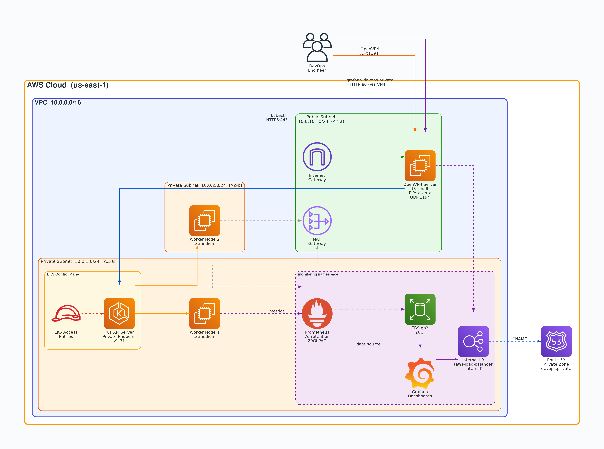

# Private EKS Cluster with OpenVPN, Prometheus & Grafana

Deploy a **fully private Amazon EKS cluster** accessible only through a self-hosted OpenVPN server, with Prometheus + Grafana monitoring and private DNS — all automated with Terraform.



## What Gets Deployed

| Resource | Description |
|----------|-------------|
| **VPC** | 10.0.0.0/16 with 2 public + 2 private subnets across 2 AZs |
| **EKS Cluster** | Private-only API endpoint (no public access), Kubernetes v1.31 |
| **Managed Node Group** | 2x t3.medium worker nodes (autoscaling: 1–3) |
| **OpenVPN EC2** | t3.small in public subnet with Elastic IP, auto-configured PKI |
| **NAT Gateway** | Outbound internet access for private subnets |
| **kube-prometheus-stack** | Prometheus (7d retention, 20Gi storage) + Grafana |
| **Internal Load Balancer** | Exposes Grafana inside VPC only |
| **Route 53 Private Zone** | `devops.private` with `grafana.devops.private` CNAME |

**Total resources:** ~60 | **Estimated cost:** ~$205/month

---

## Prerequisites

Before you begin, make sure you have the following installed and configured:

| Tool | Version | Installation |
|------|---------|-------------|
| **Terraform** | >= 1.5.0 | [terraform.io/downloads](https://developer.hashicorp.com/terraform/downloads) |
| **AWS CLI** | v2 | [docs.aws.amazon.com/cli](https://docs.aws.amazon.com/cli/latest/userguide/getting-started-install.html) |
| **kubectl** | >= 1.28 | [kubernetes.io/docs](https://kubernetes.io/docs/tasks/tools/) |
| **OpenVPN Client** | any | See [Step 5](#step-5-connect-to-vpn) for your OS |

### AWS Setup

1. **AWS CLI configured** with an IAM user/role that has permissions to create:
   - VPC, Subnets, NAT Gateway, Internet Gateway
   - EKS Cluster, Node Groups, IAM Roles
   - EC2 Instances, Security Groups, Elastic IPs
   - Route 53 Hosted Zones
   - (Or simply use `AdministratorAccess` for testing)

   ```bash
   aws configure
   # Verify
   aws sts get-caller-identity
   ```

2. **EC2 Key Pair** created in your target region:

   ```bash
   # Create a new key pair (or use an existing one)
   aws ec2 create-key-pair \
     --key-name devops \
     --query 'KeyMaterial' \
     --output text > devops.pem

   chmod 400 devops.pem
   ```

3. **Your public IP** (for SSH access restriction):

   ```bash
   curl -s ifconfig.me
   # Example output: 203.0.113.10
   ```

---

## Quick Start

If you're experienced with Terraform and AWS, here's the fast path:

```bash
git clone <repo-url> && cd eks-private-vpn

# Configure
cp terraform.tfvars.example terraform.tfvars
# Edit terraform.tfvars with your values

# Deploy
terraform init
terraform apply

# Wait for OpenVPN setup (~3-5 minutes after apply)
VPN_IP=$(terraform output -raw openvpn_public_ip)
scp -i devops.pem ubuntu@${VPN_IP}:/home/ubuntu/client-configs/client1.ovpn .
sudo openvpn --config client1.ovpn

# In another terminal — configure DNS and kubectl
sudo resolvectl dns tun0 10.0.0.2
sudo resolvectl domain tun0 "~."
aws eks update-kubeconfig --region us-east-1 --name eks-private-cluster
kubectl get nodes

# Open browser: http://grafana.devops.private (admin / your-password)
```

If that worked, you're done! If not, follow the detailed steps below.

---

## Detailed Step-by-Step Guide

### Step 1: Clone and Configure

```bash
git clone <repo-url>
cd eks-private-vpn
```

Copy the example tfvars and edit with your values:

```bash
cp terraform.tfvars.example terraform.tfvars
```

Edit `terraform.tfvars`:

```hcl
aws_region             = "us-east-1"
project_name           = "eks-private"
ssh_key_name           = "devops"                # Your EC2 key pair name
admin_ingress_cidr     = "203.0.113.10/32"       # Your IP from: curl ifconfig.me
grafana_admin_password = "YourSecurePassword"     # Change this!
```

> **Important:** Replace `203.0.113.10/32` with your actual public IP. This restricts SSH access to the VPN server to your IP only.

### Step 2: Initialize Terraform

```bash
terraform init
```

Expected output:

```
Initializing modules...
Downloading terraform-aws-modules/eks/aws 20.x.x for eks...
Downloading terraform-aws-modules/vpc/aws 5.x.x for vpc...

Initializing provider plugins...
- Installing hashicorp/aws v5.x.x
- Installing hashicorp/helm v2.x.x
- Installing hashicorp/kubernetes v2.x.x
- Installing hashicorp/tls v4.x.x

Terraform has been successfully initialized!
```

### Step 3: Deploy Infrastructure

```bash
terraform apply
```

Review the plan and type `yes` to proceed.

> **This takes 15–25 minutes.** The EKS cluster creation alone takes ~10 minutes. The Helm chart deployment adds another 5–10 minutes.

Expected output on completion:

```
Apply complete! Resources: ~60 added, 0 changed, 0 destroyed.

Outputs:

configure_kubectl = "aws eks update-kubeconfig --region us-east-1 --name eks-private-cluster"
eks_cluster_endpoint = "https://XXXXX.gr7.us-east-1.eks.amazonaws.com"
grafana_url = "http://grafana.devops.private"
openvpn_public_ip = "x.x.x.x"
ssh_to_vpn = "ssh -i <your-key.pem> ubuntu@x.x.x.x"
```

### Step 4: Wait for OpenVPN Setup

The OpenVPN server configures itself via user data script after the EC2 instance launches. This takes **3–5 minutes** after Terraform completes.

To check if it's ready:

```bash
VPN_IP=$(terraform output -raw openvpn_public_ip)

# SSH into the VPN server
ssh -i devops.pem ubuntu@${VPN_IP}

# Check the setup log
tail -f /var/log/openvpn-setup.log
```

Wait until you see:

```
=== OpenVPN setup complete ===
```

Then verify the client config was generated:

```bash
ls -la /home/ubuntu/client-configs/client1.ovpn
```

Exit the SSH session:

```bash
exit
```

### Step 5: Connect to VPN

Download the client profile:

```bash
VPN_IP=$(terraform output -raw openvpn_public_ip)
scp -i devops.pem ubuntu@${VPN_IP}:/home/ubuntu/client-configs/client1.ovpn .
```

Connect using OpenVPN:

**Linux:**
```bash
sudo openvpn --config client1.ovpn
```

**macOS (Tunnelblick):**
```bash
# Install Tunnelblick from https://tunnelblick.net
# Double-click client1.ovpn to import, then connect
```

**Windows (OpenVPN GUI):**
```
# Install OpenVPN GUI from https://openvpn.net/community-downloads/
# Copy client1.ovpn to C:\Users\<you>\OpenVPN\config\
# Right-click the OpenVPN GUI tray icon → Connect
```

Wait for the connection to establish. You should see:

```
Initialization Sequence Completed
```

Verify the tunnel is working:

```bash
# You should have a tun0 interface with a 10.8.0.x IP
ip addr show tun0

# Verify you can reach the VPC
ping -c 3 10.0.0.2
```

### Step 6: Configure DNS Resolution

Your local machine needs to know to use the VPC DNS server (10.0.0.2) for resolving private hostnames like `grafana.devops.private`.

**Linux (systemd-resolved):**

```bash
sudo resolvectl dns tun0 10.0.0.2
sudo resolvectl domain tun0 "~."
```

Verify:

```bash
resolvectl status tun0
```

Expected output:

```
Link 6 (tun0)
    Current Scopes: DNS
Current DNS Server: 10.0.0.2
       DNS Servers: 10.0.0.2
        DNS Domain: ~.
```

**macOS:**

```bash
# Find your VPN interface name
networksetup -listallnetworkservices

# Set DNS (replace "utun3" with your actual interface)
sudo networksetup -setdnsservers "utun3" 10.0.0.2
```

Or manually:
1. System Preferences > Network > select VPN connection > Advanced > DNS
2. Add `10.0.0.2`

**Windows:**

```powershell
# In PowerShell (Admin)
# Find the VPN adapter name
Get-NetAdapter | Where-Object {$_.InterfaceDescription -like "*TAP*"}

# Set DNS
Set-DnsClientServerAddress -InterfaceAlias "OpenVPN TAP" -ServerAddresses 10.0.0.2
```

### Step 7: Configure kubectl

```bash
aws eks update-kubeconfig --region us-east-1 --name eks-private-cluster
```

Verify cluster access:

```bash
kubectl get nodes
```

Expected output:

```
NAME                             STATUS   ROLES    AGE   VERSION
ip-10-0-1-xxx.ec2.internal      Ready    <none>   20m   v1.31.x
ip-10-0-2-xxx.ec2.internal      Ready    <none>   20m   v1.31.x
```

Check the monitoring namespace:

```bash
kubectl get pods -n monitoring
```

Expected output (all pods Running):

```
NAME                                                       READY   STATUS    RESTARTS
kube-prometheus-stack-grafana-xxxxxxxxx-xxxxx               3/3     Running   0
kube-prometheus-stack-kube-state-metrics-xxxxxxxxx-xxxxx    1/1     Running   0
kube-prometheus-stack-operator-xxxxxxxxx-xxxxx              1/1     Running   0
kube-prometheus-stack-prometheus-node-exporter-xxxxx        1/1     Running   0
prometheus-kube-prometheus-stack-prometheus-0               2/2     Running   0
alertmanager-kube-prometheus-stack-alertmanager-0           2/2     Running   0
```

### Step 8: Access Grafana

Verify DNS resolution:

```bash
nslookup grafana.devops.private
```

Expected output:

```
Server:    10.0.0.2
Address:   10.0.0.2#53

Name:      grafana.devops.private
Address:   10.0.1.xxx
```

Open your browser and navigate to:

```
http://grafana.devops.private
```

Login credentials:
- **Username:** `admin`
- **Password:** the value you set in `grafana_admin_password` (default: `admin`)

You now have access to pre-built dashboards:
- Kubernetes / Compute Resources / Cluster
- Kubernetes / Compute Resources / Namespace (Pods)
- Node Exporter / Nodes
- Prometheus / Overview

---

## Troubleshooting

### "You must be logged in to the server"

**Cause:** EKS Access Entry not created for your IAM identity.

**Fix:** Ensure `enable_cluster_creator_admin_permissions = true` is set in the EKS module, then run:

```bash
terraform apply
```

Also verify your AWS identity:

```bash
aws sts get-caller-identity
```

The ARN shown must match the one that ran `terraform apply`.

---

### VPN connects but can't reach VPC resources

**Cause:** `source_dest_check` might still be enabled on the VPN EC2 instance.

**Verify:**

```bash
aws ec2 describe-instance-attribute \
  --instance-id $(terraform output -raw openvpn_instance_id 2>/dev/null || \
    aws ec2 describe-instances --filters "Name=tag:Name,Values=eks-private-openvpn" \
    --query 'Reservations[0].Instances[0].InstanceId' --output text) \
  --attribute sourceDestCheck
```

If `"Value": true`, run `terraform apply` again — it should set it to `false`.

---

### OpenVPN client profile not found

**Cause:** The user data script hasn't finished yet.

**Fix:** SSH into the VPN server and check:

```bash
VPN_IP=$(terraform output -raw openvpn_public_ip)
ssh -i devops.pem ubuntu@${VPN_IP}
tail -20 /var/log/openvpn-setup.log
```

If the script is still running, wait for `=== OpenVPN setup complete ===`.

If the script failed, check the full log:

```bash
cat /var/log/openvpn-setup.log
```

---

### DNS resolution not working (`grafana.devops.private` doesn't resolve)

**Cause:** Your machine isn't using the VPC DNS server through the VPN tunnel.

**Fix (Linux):**

```bash
sudo resolvectl dns tun0 10.0.0.2
sudo resolvectl domain tun0 "~."
```

**Verify:**

```bash
nslookup grafana.devops.private
# Should return a 10.0.x.x address
```

> **Note:** These settings reset when you disconnect from the VPN. You need to re-run them each time you reconnect.

---

### Helm chart failed during `terraform apply`

**Cause:** DNS resolution timeout — the Terraform process couldn't resolve the private EKS endpoint.

**Fix:**

1. Connect to VPN and configure DNS first (Steps 5–6)
2. Clean up the failed Helm release:

   ```bash
   helm uninstall kube-prometheus-stack -n monitoring
   ```

3. Re-run Terraform (make sure VPN and DNS are active in the same terminal):

   ```bash
   terraform apply
   ```

---

### SSH Permission Denied

**Cause:** Wrong key file path or permissions.

**Fix:**

```bash
# Ensure correct permissions
chmod 400 devops.pem

# Use the correct path
ssh -i /full/path/to/devops.pem ubuntu@$(terraform output -raw openvpn_public_ip)
```

---

### EKS version upgrade fails

**Cause:** AWS only allows upgrading one minor version at a time.

**Fix:** Increment `kubernetes_version` one step at a time:

```hcl
# 1.29 → 1.30 → 1.31 → 1.32 → 1.33
# Run terraform apply after each change
```

---

## File Reference

| File | Purpose |
|------|---------|
| `main.tf` | VPC module, EKS module, OpenVPN EC2 instance, Security Groups, Elastic IP |
| `monitoring.tf` | Monitoring namespace, kube-prometheus-stack Helm release |
| `dns.tf` | Route 53 private hosted zone, Grafana CNAME record |
| `providers.tf` | AWS, Helm, Kubernetes, TLS provider configuration |
| `variables.tf` | All input variables with defaults |
| `outputs.tf` | VPN IP, kubectl command, Grafana URL, LB hostname |
| `openvpn_userdata.sh` | OpenVPN server bootstrap — PKI, config, NAT, client profile |
| `terraform.tfvars.example` | Example configuration values |

---

## Variables

| Variable | Default | Description |
|----------|---------|-------------|
| `aws_region` | `us-east-1` | AWS region to deploy in |
| `project_name` | `eks-private` | Prefix for all resource names |
| `vpc_cidr` | `10.0.0.0/16` | VPC CIDR block |
| `availability_zones` | `["us-east-1a", "us-east-1b"]` | AZs for subnet distribution |
| `private_subnet_cidrs` | `["10.0.1.0/24", "10.0.2.0/24"]` | Private subnet CIDRs |
| `public_subnet_cidrs` | `["10.0.101.0/24", "10.0.102.0/24"]` | Public subnet CIDRs |
| `kubernetes_version` | `1.31` | EKS Kubernetes version |
| `node_instance_types` | `["t3.medium"]` | Worker node instance types |
| `node_desired_size` | `2` | Desired number of worker nodes |
| `node_min_size` | `1` | Minimum worker nodes |
| `node_max_size` | `3` | Maximum worker nodes |
| `openvpn_instance_type` | `t3.small` | VPN server instance type |
| `vpn_client_cidr` | `10.8.0.0/24` | IP range assigned to VPN clients |
| `ssh_key_name` | — | **Required.** EC2 key pair name |
| `admin_ingress_cidr` | — | **Required.** Your public IP/32 |
| `grafana_admin_password` | `admin` | Grafana admin password (sensitive) |

---

## Outputs

| Output | Description |
|--------|-------------|
| `vpc_id` | VPC ID |
| `eks_cluster_name` | EKS cluster name |
| `eks_cluster_endpoint` | EKS private API endpoint URL |
| `openvpn_public_ip` | OpenVPN server Elastic IP |
| `ssh_to_vpn` | Ready-to-use SSH command |
| `configure_kubectl` | Ready-to-use kubeconfig command |
| `grafana_url` | Grafana URL (`http://grafana.devops.private`) |
| `grafana_lb_hostname` | Grafana internal load balancer hostname |
| `route53_private_zone_id` | Route 53 private hosted zone ID |

---

## Security

- **EKS API:** Private endpoint only — not reachable from the internet
- **Grafana:** Internal load balancer — not reachable from the internet
- **OpenVPN:** Certificate-based mutual TLS + HMAC pre-shared key (`tls-auth`)
- **SSH:** Restricted to `admin_ingress_cidr` (your IP only)
- **DNS:** Private hosted zone — `devops.private` is not resolvable outside the VPC
- **IAM:** EKS Access Entries for cluster RBAC (not legacy ConfigMap)
- **Encryption:** AES-256-GCM cipher, SHA256 HMAC for VPN traffic

The **only** internet-facing resource is the OpenVPN server on UDP:1194.

---

## Clean Up

To destroy all resources and stop incurring charges:

```bash
terraform destroy
```

Type `yes` to confirm. This removes everything: VPC, EKS, EC2, Route 53, all Kubernetes resources.

> **Note:** If the Helm release is in a failed state, you may need to manually clean it up first:
> ```bash
> helm uninstall kube-prometheus-stack -n monitoring
> terraform destroy
> ```

---

## License

MIT
